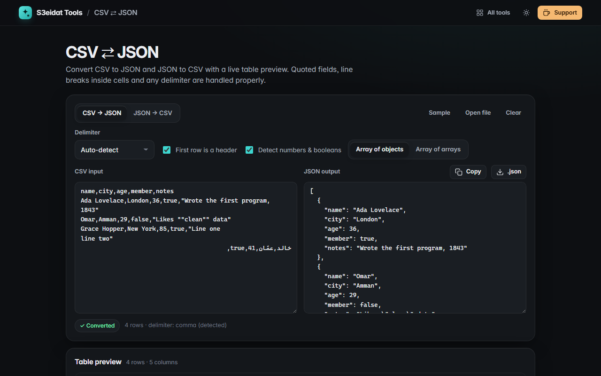

# CSV ⇄ JSON

> Convert CSV to JSON and JSON to CSV with a live table preview. Free, private, and it runs entirely in your browser.

### ▶ [Open CSV ⇄ JSON](https://s3eidat.github.io/csv-json/)



## Features

- **RFC 4180 CSV parser**: quoted fields, `""` escapes, commas and **line breaks inside quotes**, CRLF/LF/CR, BOM
- **Delimiter auto-detect** (comma, semicolon, tab, pipe) or pick one
- **Header toggle**; duplicate or empty header names are made unique
- **CSV → JSON** as an array of objects or an array of arrays, with optional number/boolean detection
  (leading-zero values like ZIP codes and long IDs stay strings)
- **JSON → CSV**: nested objects and arrays are **flattened with dots** (`address.city`, `tags.0`),
  columns are the union of all keys, and values are quoted only when needed
- **Formula guard** (on by default): text cells starting with `=`, `+`, `-` or `@` get a `'` prefix so a spreadsheet
  won't run them as formulas; optional UTF-8 BOM so Excel shows Arabic and accents correctly
- **Table preview** of the first 200 rows; open or drop a file, copy, or download `.json` / `.csv`
- Switching direction carries the result over, so you can round-trip

## Privacy

Your data never leaves your device. There is no server, no account, no analytics.
The page ships with a strict Content-Security-Policy (`connect-src 'self'`), so the browser
itself blocks any attempt to send data anywhere.

## Run it yourself

It's plain HTML, CSS and JavaScript with no build step:

```bash
git clone https://github.com/s3eidat/csv-json
cd csv-json
python -m http.server 8000
```

Then open http://localhost:8000.

## Support

If this saved you time, **[buy me a coffee ☕](https://s3eidat.github.io/coffee/)**. It keeps every tool free.

---

Part of **[S3eidat Tools](https://s3eidat.github.io/)**: 100+ free, private tools that run in your browser. MIT licensed.
